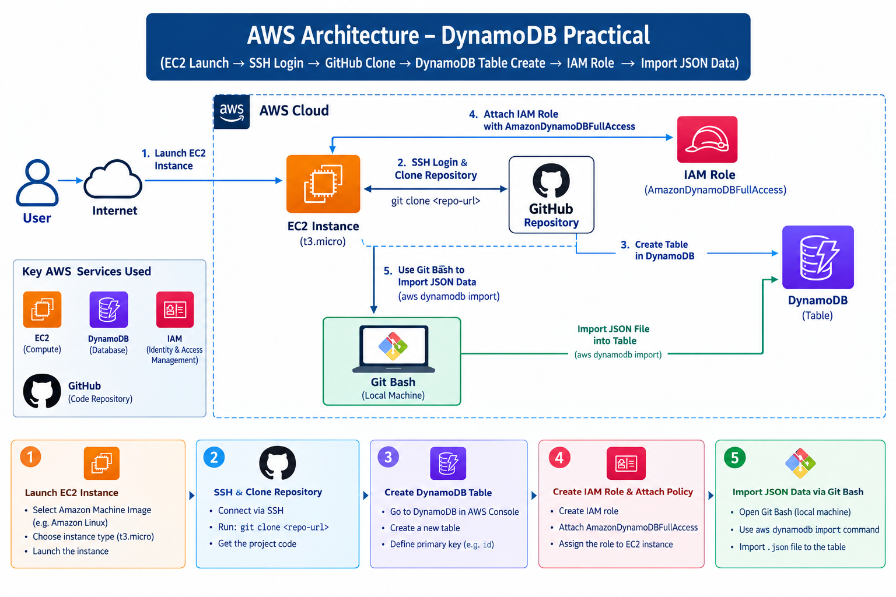
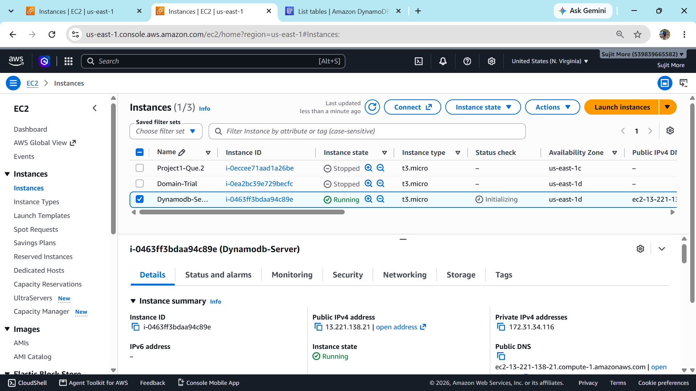
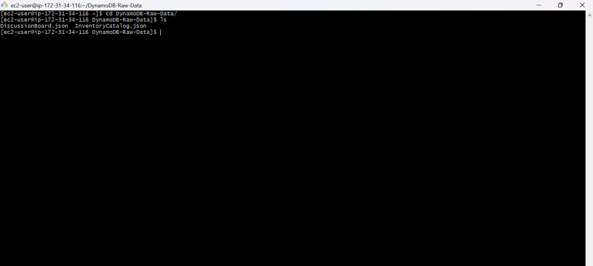
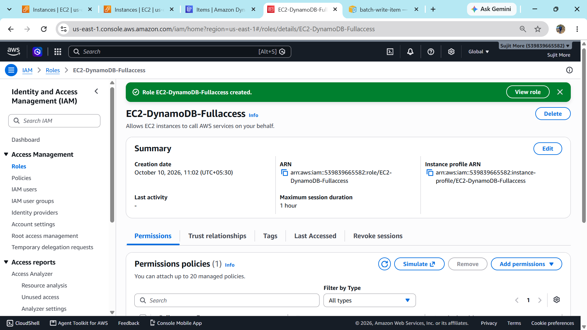
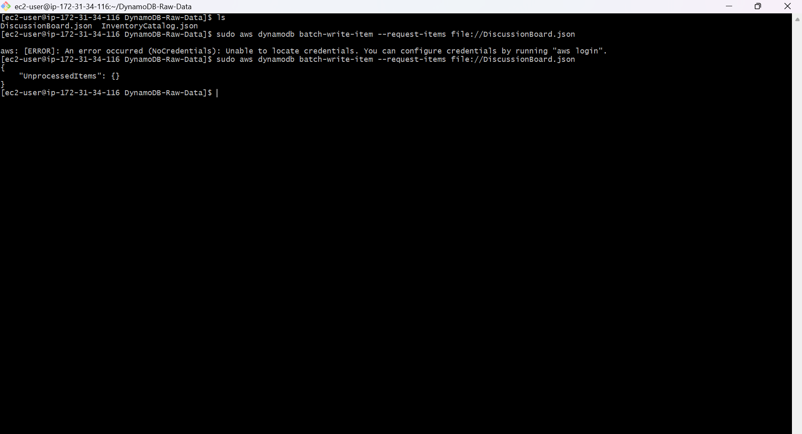
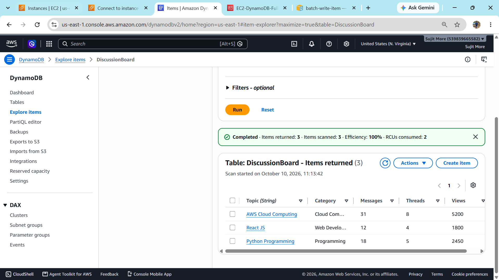

# AWS DynamoDB Practical 

This project demonstrates how to load JSON data into an Amazon DynamoDB table using the AWS CLI from an EC2 instance. The EC2 instance receives DynamoDB permissions through an IAM role, and the data files are obtained from a GitHub repository.

## Architecture Diagram



## AWS Services and Tools

- **Amazon EC2** — Linux instance (`t3.micro`) used to run AWS CLI commands.
- **Amazon DynamoDB** — NoSQL database table named `DiscussionBoard`.
- **AWS IAM** — Role `EC2-DynamoDB-Fullaccess` attached to the EC2 instance with the `AmazonDynamoDBFullAccess` managed policy for this practical.
- **GitHub** — Hosts the project repository and JSON data files.
- **SSH / Git Bash / AWS CLI** — Used to connect to the instance, clone the repository, and import the data.

## Practical Workflow

1. Launch an EC2 instance (the screenshot shows a `t3.micro` instance in **US East (N. Virginia), `us-east-1`**).
2. Connect to the instance using SSH.
3. Clone the GitHub repository containing the project code and JSON data.
4. Open Amazon DynamoDB in the AWS Console and create the `DiscussionBoard` table with the required primary key.
5. Create the IAM role `EC2-DynamoDB-Fullaccess`, attach the `AmazonDynamoDBFullAccess` policy, and associate the role with the EC2 instance through an instance profile.
6. From the EC2 terminal, move into the cloned repository directory and check the JSON files.
7. Use the AWS CLI `batch-write-item` command to import the JSON data into DynamoDB.
8. Open the DynamoDB table's **Explore items** view and verify that the records were imported.

## Import JSON Data

Example command used for the `DiscussionBoard.json` file:

```bash
aws dynamodb batch-write-item --request-items file://DiscussionBoard.json
```

Run the command from the directory where `DiscussionBoard.json` is located. The JSON file must use the DynamoDB `batch-write-item` request structure, with a `RequestItems` object containing the table name and `PutRequest` items.

Example structure:

```json
{
  "DiscussionBoard": [
    {
      "PutRequest": {
        "Item": {
          "Topic": { "S": "AWS Cloud Computing" },
          "Category": { "S": "Cloud Computing" }
        }
      }
    }
  ]
}
```

Use the actual JSON file and attribute names from your repository. The example above is illustrative; it is not a replacement for your original data file.

## Screenshots

### 1. EC2 Instance
EC2 instance running in the AWS Console.



### 2. GitHub Repository Cloned
Terminal showing the cloned project directory and JSON files.



### 3. IAM Role and Policies
IAM policies created for EC2 to access DynamoDB.



### 4. Import JSON Data Using AWS CLI
Terminal showing the `batch-write-item` command and its response.



### 5. Verify Data in DynamoDB
DynamoDB `DiscussionBoard` table displaying imported items.



## Important Security Note

`AmazonDynamoDBFullAccess` is broad access and is suitable only as a quick learning/practical setup. For production, follow least privilege and create a custom IAM policy limited to the required DynamoDB actions and the specific table ARN.

## Result

Successfully configured EC2-to-DynamoDB access using an IAM role, imported JSON records through the AWS CLI, and verified the records in the DynamoDB console.
